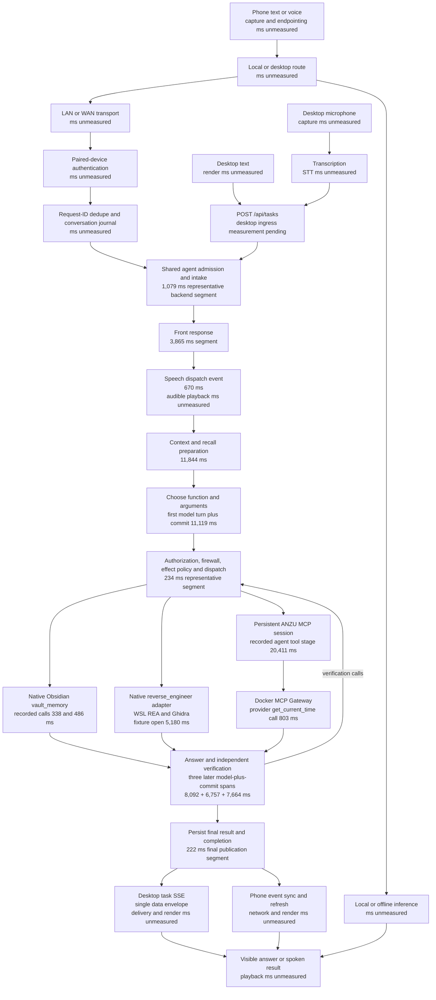

# ANZU tool path and latency

Measured on 11 November 2026 on the installed Windows backend. The isolated code checkout started from development commit 9a544982. Samples ran on an active desktop with other workloads.

## Steps and checkpoints

| Step | Result |
| --- | --- |
| Fetch current ANZU | Branch cursor/mcp-tools-99ea from current development |
| Download gateway | Official Docker MCP Gateway checkout 7e0f3427 and CLI 0.43.3 |
| Load preset catalog | Official catalog containing 313 server presets |
| Connect gateway | Installed docker_catalog connection with a pinned Time server. API and real model-selected calls succeeded |
| Use Obsidian | Existing vault_memory adapter completed a model task with two read-only searches |
| Use REA | Existing reverse_engineer adapter opened a local test archive and saved evidence. A model-selected status call returned ready |
| Trace flow | Backend spans below. Physical-phone and client-render timings remain pending |

Time is the active Docker catalog connection. Obsidian and REA use their existing native adapters. Other catalog services have preset definitions available for configuration.

## Prompt flow

This graph covers a tool-using request. The normal desktop HUD posts to /api/tasks. The owner-chat API delegates tool requests to the same AGENT.create_task path. The detailed timeline below comes from an owner-chat loopback API sample.



The graph combines shared architecture and separate measured scenarios. Provider RPC time is nested within the larger MCP tool stage.

## Detailed timeline

The successful vault task was observed from loopback HTTP submission to terminal state in 67,872 ms. Its recorded first response was 4,940 ms from the backend turn timer. It made four model calls and two vault searches.

These intervals run consecutively from backend acknowledgement through completion. Boundaries include scheduling and durable event work.

| Step | Event-bounded segment | ms |
| --- | --- | --- |
| 1 | Admission, intake and front scheduling | 1,079 |
| 2 | Front response segment | 3,865 |
| 3 | Speech dispatch event | 670 |
| 4 | Worker context and recall preparation | 11,844 |
| 5 | First model turn and durable commit | 11,119 |
| 6 | Policy, dispatch and event persistence | 234 |
| 7 | First tool stage and observation publication | 3,626 |
| 8 | Next-turn preparation | 471 |
| 9 | Answer model turn and durable commit | 8,092 |
| 10 | Independent verification setup | 4,914 |
| 11 | Verification model turn and durable commit | 6,757 |
| 12 | Verification-tool dispatch | 630 |
| 13 | Second tool stage and observation publication | 3,501 |
| 14 | Final-turn preparation | 174 |
| 15 | Final model turn and durable commit | 7,664 |
| 16 | Completion publication | 222 |

The two recorded vault execution durations were 338 ms and 486 ms, totalling 824 ms. The broader tool-event spans include dispatch, journaling and observation publication.

The client measurement used HTTP polling. Its final observation includes polling delay. The normal desktop task-entry sample is recorded separately in desktop-task-progress.json.

## Bottlenecks

| Finding | Evidence |
| --- | --- |
| Repeated model turns | Four model-plus-commit spans total 33,633 ms in the vault case |
| Context and recall preparation | 11,844 ms between front speech dispatch and the first worker-model event |
| Verification work | A simple search used a second search and three model turns after the first tool decision |
| MCP wrapper overhead | One accepted agent call recorded 20,411 ms while Docker measured 803 ms for the provider operation. Narrower spans are needed to attribute the remainder |
| Cold REA session | Catalog acquisition took 18,549 ms and fixture open took 5,180 ms |
| Blocking probes | The event-loop stall log captured Windows gateway and hardware subprocess probes on the event-loop thread |
| Incomplete model accounting | task.model_ms remained 0 for successful Ollama calls. This report uses measured event spans |
| Client timing gaps | Phone network, microphone endpointing, browser paint and audible playback need device/client capture |

Three gateway API-call samples after the persistent-session correction were 1,181 ms, 2,978 ms and 875 ms. They were collected under desktop load.

## Task samples

These durations use database task creation and finish timestamps.

| Scenario | Final state | Backend task duration ms | Model calls | Recorded tool ms |
| --- | --- | --- | --- | --- |
| vault owner chat | completed | 67,230 | 4 | 824 |
| gateway owner chat | completed | 267,671 | 4 | 20,411 |
| rea owner chat | failed | 284,139 | 1 | 42,358 |

The first REA status attempt returned ready through the tool, then its reporting turn encountered a transient inference connection error. Its model-visible status output has since been compacted, retaining the full result in ToolResult.data.

## Corrections

- Explicit multi-word tool requests enter the agent path and retain tool schemas.
- Small-model selection retains the requested namespaced MCP function.
- MCP SDK 2.x serialization preserves inputSchema and required arguments.
- Persistent MCP transport scopes enter and exit in a dedicated owner task.
- Direct MCP reads and mcp_call proxy reads share observational policy.
- Read-only vault operations have observational effect metadata.
- The optional learned harm veto applies to state-changing actions after the existing hard policy checks.
- Live Ollama context is resolved against the selected model.
- The selected model's default context was set to 32,768 tokens after tool requests exceeded its 4,096-token default. Original model metadata and Modelfile were saved locally.
- REA status text is compact. The full result remains in ToolResult.data.
- Desktop task SSE frames use one data envelope.

## Resume and reproduce

The checkpoint folder contains RESUME.md, trace.py, trace-task.py, export-evidence.py, accepted-evidence.json, timing logs, connection JSON and installed-file backups.

Start with RESUME.md. Resume a desktop task with trace-task.py followed by its task ID. Run export-evidence.py before build-flow.py to refresh this report.

The downloaded gateway is at the separate local Projects/mcp-gateway checkout. The active Time image is pinned to mcp/time@sha256:9c46a918633fb474bf8035e3ee90ebac6bcf2b18ccb00679ac4c179cba0ebfcf.

The official catalog can be loaded and a profile prepared with the following commands.

```powershell
docker mcp catalog pull mcp/docker-mcp-catalog
docker mcp profile create --name "ANZU Catalog" --id anzu-catalog --server catalog://mcp/docker-mcp-catalog/time
docker mcp gateway run --profile anzu-catalog
```

## Verification limits

Focused tests passed. The final count is recorded in focused-final.log and RESUME.md.

An unfiltered suite stalled in a persona-decision test. Another run reached 650 passing tests and six skips before Windows separator assertions failed. Those separator failures also reproduced on untouched development. Full-suite green remains unverified.

Physical-phone timings are pending. Installed ADB reported no attached device. Rendered-client and audible-playback measurements remain pending.

## Sources

The gateway and preset catalog are documented by Docker. [Gateway repository](https://github.com/docker/mcp-gateway), [MCP catalog](https://docs.docker.com/ai/mcp-catalog-and-toolkit/catalog/)

Ollama documents context configuration and model parameters. [Context length](https://docs.ollama.com/context-length), [Modelfile parameters](https://docs.ollama.com/modelfile)
